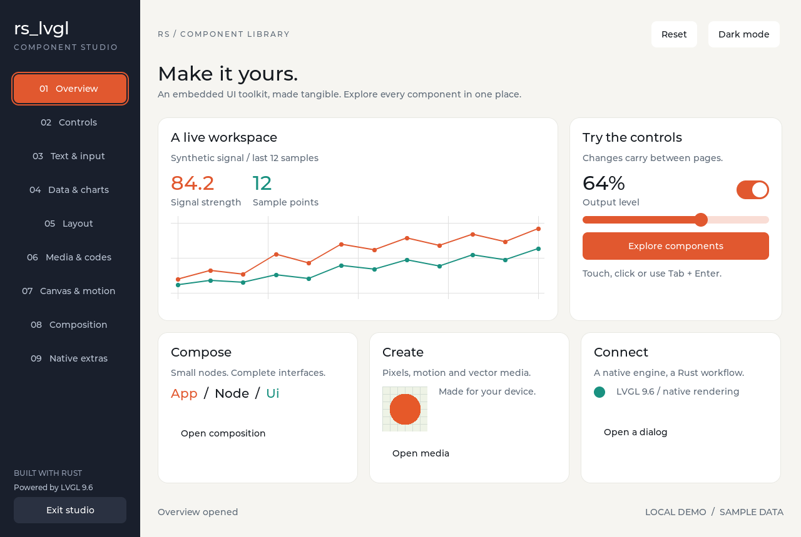

# rs_lvgl

**English** · [简体中文](README.zh.md)

Rust bindings and declarative UI for [LVGL](https://lvgl.io/) 9.6.

Use LVGL widgets directly from Rust, or build screens with `rs_lvgl_ui` and
update them through messages. Run your interface on the desktop with SDL2,
then connect it to your device's display and input drivers.



## Try the demo

The component studio includes controls, charts, text input, layouts, media,
and navigation, with light and dark themes.
[Browse the gallery](docs/component-studio.md) or explore the
[smaller examples](examples/README.md).

You'll need Rust, a C/C++ compiler, libclang, SDL2, and pkg-config.

```sh
# Debian / Ubuntu
sudo apt-get install build-essential clang libclang-dev pkg-config libsdl2-dev

# macOS, with Xcode Command Line Tools installed
brew install sdl2 pkg-config
```

From the repository root:

```sh
cargo run -p rs_lvgl_ui --example studio --features showcase
```

## Use in your project

| Crate | Purpose |
| --- | --- |
| [`rs_lvgl_ui`](rs_lvgl_ui/README.md) | Declarative screens, typed events, themes, and reusable components |
| [`rs_lvgl`](rs_lvgl/) | Rust wrappers for widgets, displays, input, styles, and timers |
| [`rs_lvgl_sys`](rs_lvgl_sys/README.md) | Raw LVGL bindings, native configuration, custom C sources, and fonts |
| [`rs_lvgl_codegen`](rs_lvgl_codegen/README.md) | Widget wrapper generation used by the build |

Use path dependencies from a local checkout. For an application next to the
`rs_lvgl` repository:

```toml
[dependencies]
rs_lvgl = { path = "../rs_lvgl/rs_lvgl", default-features = false, features = ["alloc"] }
rs_lvgl_ui = { path = "../rs_lvgl/rs_lvgl_ui" }
```

`rs_lvgl` and `rs_lvgl_ui` support `no_std`. Embedded applications using the UI
layer need an allocator and platform-specific display and input drivers.

## Define a screen

An `App` holds your state. Its `view` builds a tree of nodes; input sends messages
to `update`. `Ui` applies those changes to the LVGL widgets.

```rust
use rs_lvgl_ui::{App, Key, Node, Style, Theme};

#[derive(Clone)]
enum Msg {
    Increment,
}

struct Counter {
    value: u32,
}

impl App for Counter {
    type Msg = Msg;

    fn update(&mut self, _: Msg) {
        self.value += 1;
    }

    fn view(&self, theme: &Theme) -> Node<Msg> {
        Node::column()
            .style(Style::default().gap(12))
            .child(Node::label(format!("Count: {}", self.value)))
            .child(
                Node::button("Add one")
                    .key(Key::Named("increment"))
                    .style(Style::accent(theme))
                    .on_click(Msg::Increment),
            )
    }
}
```

See the [complete counter example](.agents/skills/rs-lvgl-ui/references/counter.rs)
for display setup and the event loop, or the [UI guide](rs_lvgl_ui/README.md)
for layouts, styling, and events.

## Choose widgets and fonts

Disable the default feature set to select the widgets and fonts you need:

```toml
rs_lvgl_ui = { path = "../rs_lvgl/rs_lvgl_ui", default-features = false, features = [
    "alloc", "components", "widget-slider", "widget-switch", "font-montserrat-16"
] }
```

Labels, buttons, and row, column, and grid layouts are always available.
QR codes, barcodes, GIF, Lottie, Pinyin input, and CJK fonts are optional.
See [feature selection](rs_lvgl_ui/README.md#choosing-widgets) for the full list.

## Documentation

- [UI guide](rs_lvgl_ui/README.md) — components, state, styling, and input.
- [Native integration](rs_lvgl_sys/README.md) — `lv_conf.h`, custom C sources, and fonts.
- [Testing](docs/testing.md) — test commands and simulator checks.
- [Changelog](CHANGELOG.md).

## AI coding assistants

The included `rs-lvgl-ui` and `rs-lvgl-native` skills provide API examples and
integration guidance for coding assistants. Install them with:

```sh
python3 scripts/install-skills.py --dest ~/.agents/skills
```

See [skill setup](docs/ai-skills.md) for project-local installation and usage.

## License

Rust code is licensed under [MIT](LICENSE), with credits to Rafael Carício,
Nia Espera, and the other contributors to the original bindings. LVGL, ThorVG,
and other bundled dependencies retain their own licenses.
