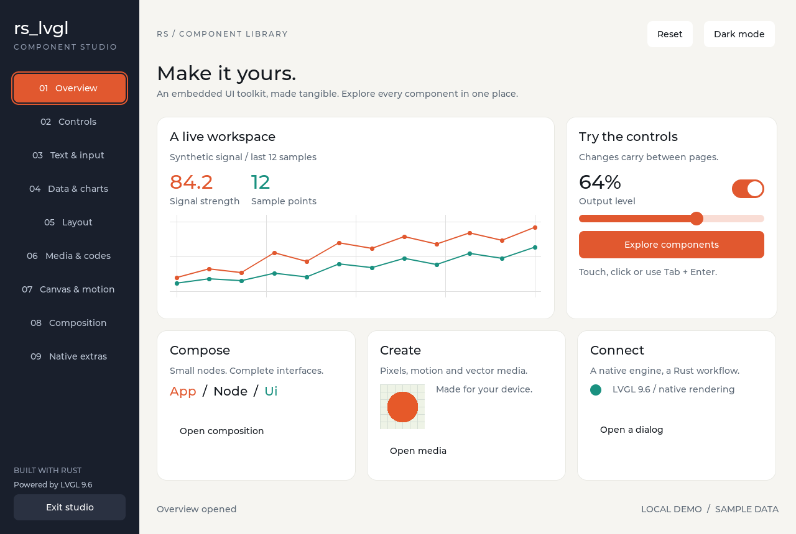

# rs_lvgl

0.8.0 增加可配置的 RGB888/RGB565 显示缓冲区、渲染模式、无效区域对齐，以及独立的显示与输入周期。
同时改进 tick 精度、长时间运行的时钟回绕和大绘图缓冲区的堆分配。
从 0.7.0 升级时请参阅[迁移指南](docs/ui-api-migration.md)。

[English](https://github.com/umbrella22/rs_lvgl/blob/main/README.md) · **简体中文**

[文档](https://umbrella22.github.io/rs_lvgl_website/) · [快速开始](https://umbrella22.github.io/rs_lvgl_website/guide/getting-started.html) · [组件预览](https://umbrella22.github.io/rs_lvgl_website/studio.html) · [演练场](https://umbrella22.github.io/rs_lvgl_website/playground.html)

面向 [LVGL](https://lvgl.io/) 9.6 的 Rust 绑定与声明式 UI 库。

可以直接使用 Rust 封装的 LVGL 控件，也可以用 `rs_lvgl_ui` 描述界面，通过消息更新状态。
开发时用 SDL2 在桌面运行界面，再接入设备的显示与输入驱动。



## 运行示例

[组件预览](https://umbrella22.github.io/rs_lvgl_website/studio.html)使用 WebAssembly 运行同一套 Rust/LVGL 视图，支持输入和动画。
也可以在[演练场](https://umbrella22.github.io/rs_lvgl_website/playground.html)修改示例，直接在浏览器中操作运行结果。

组件工作台包含基础控件、图表、文本输入、布局、多媒体和导航，支持明暗主题。
也可以浏览[组件图集](https://github.com/umbrella22/rs_lvgl/blob/main/docs/component-studio.md)或从[小型示例](https://github.com/umbrella22/rs_lvgl/blob/main/examples/README.md)入手。

需要 Rust、C/C++ 编译器、libclang、SDL2 和 pkg-config。

```sh
# Debian / Ubuntu
sudo apt-get install build-essential clang libclang-dev pkg-config libsdl2-dev

# macOS：先安装 Xcode Command Line Tools
brew install sdl2 pkg-config
```

在仓库根目录运行：

```sh
cargo run -p rs_lvgl_ui --example studio --features showcase
```

## 接入项目

| Crate | 用途 |
| --- | --- |
| [`rs_lvgl_ui`](https://github.com/umbrella22/rs_lvgl/blob/main/rs_lvgl_ui/README.md) | 声明式界面、类型化事件、主题和可复用组件 |
| [`rs_lvgl`](https://github.com/umbrella22/rs_lvgl/tree/main/rs_lvgl) | 控件、显示、输入、样式和计时器的 Rust 封装 |
| [`rs_lvgl_sys`](https://github.com/umbrella22/rs_lvgl/blob/main/rs_lvgl_sys/README.md) | 原始 LVGL 绑定、原生配置、自定义 C 源码与字体 |
| [`rs_lvgl_codegen`](https://github.com/umbrella22/rs_lvgl/blob/main/rs_lvgl_codegen/README.md) | 构建时使用的控件封装生成器 |

在项目中添加 crates.io 依赖：

```toml
[dependencies]
rs_lvgl = { version = "0.8.0", default-features = false, features = ["alloc"] }
rs_lvgl_ui = "0.8.0"
```

`rs_lvgl` 和 `rs_lvgl_ui` 支持 `no_std`。在嵌入式设备上使用 UI 层时，
需要提供分配器以及对应的显示和输入驱动。

[运行时契约](https://github.com/umbrella22/rs_lvgl/blob/main/docs/ui-runtime.md)说明了
`NativeObject` 的安全要求、动态资源生命周期和原生配置。

## 描述界面

`App` 保存应用状态，`view` 用普通函数构建 `View<CounterAction>`，输入通过消息交给 `update` 处理。

下面的示例使用 0.8.0 API。`CounterAction` 是计数器自己的操作枚举，
`type Action = CounterAction` 将它关联到框架；状态保存在 `Counter`，操作逻辑写在 `update` 中。
`Ui` 负责将变化应用到 LVGL 控件。

```rust
use rs_lvgl_ui::prelude::*;

#[derive(Clone)]
enum CounterAction {
    Increment,
}

struct Counter {
    value: u32,
}

impl App for Counter {
    type Action = CounterAction;

    fn update(&mut self, _: CounterAction) {
        self.value += 1;
    }

    fn view(&self, theme: &Theme) -> View<CounterAction> {
        column([
            label(format!("Count: {}", self.value))
                .font(theme.title_font)
                .text_color(theme.text),
            button("Add one")
                .key(Key::Named("increment"))
                .style(Style::accent(theme))
                .on_click(CounterAction::Increment),
        ])
        .gap(12)
    }
}
```

[完整的计数器示例](https://github.com/umbrella22/rs_lvgl/blob/main/.agents/skills/rs-lvgl-ui/references/counter.rs)包含显示初始化和事件循环；
布局、样式和事件的用法见 [UI 指南](https://github.com/umbrella22/rs_lvgl/blob/main/rs_lvgl_ui/README.md)。

## 组合与表单

0.8.0 提供惰性条件组合、语义事件、组件插槽、`typed::...` 构造和显式表单绑定。
[组合与表单指南](docs/ui-composition.md)包含类型转换、受控输入和内容复用的写法。
原有的根模块和 prelude 普通构造函数仍然可用。

## 选择控件与字体

关闭默认 feature 后，可以按需选择控件和字体：

```toml
[dependencies.rs_lvgl_ui]
version = "0.8.0"
default-features = false
features = [
    "alloc", "components", "widget-slider", "widget-switch", "font-montserrat-16"
]
```

标签、按钮、行列布局和网格布局始终可用。
二维码、条码、GIF、Lottie、拼音输入和 CJK 字体可单独启用。
完整列表见[控件选择](https://github.com/umbrella22/rs_lvgl/blob/main/rs_lvgl_ui/README.md#choosing-widgets)。

## 文档

[显示接入指南](docs/display.md)说明 RGB888 字节缓冲区、渲染模式、异步刷新契约和设备自行选择的软件周期。

需要远程检查 UI 时，可参考 [EmbedScope 接入示例](examples/embedscope/README.md)和[调试指南](https://umbrella22.github.io/rs_lvgl_website/guide/embedscope.html)。
调试由应用显式启用；release 优化不会关闭已经选择的 feature。库的默认配置不会启动诊断接口。

使用指南和 GitHub Pages 部署在独立仓库 [rs_lvgl_website](https://github.com/umbrella22/rs_lvgl_website) 中维护。

- [使用指南（中文）](https://umbrella22.github.io/rs_lvgl_website/) · [English](https://umbrella22.github.io/rs_lvgl_website/en/)：安装、声明式界面、组件、输入、原生集成与开发检查。
- [UI 指南](https://github.com/umbrella22/rs_lvgl/blob/main/rs_lvgl_ui/README.md)：组件、状态、样式与输入。
- [原生集成](https://github.com/umbrella22/rs_lvgl/blob/main/rs_lvgl_sys/README.md)：`lv_conf.h`、自定义 C 源码与字体。
- [测试指南](https://github.com/umbrella22/rs_lvgl/blob/main/docs/testing.md)：测试命令与模拟器检查。
- [更新记录](https://github.com/umbrella22/rs_lvgl/blob/main/CHANGELOG.md)。

## AI 编程助手

仓库提供 `rs-lvgl-ui` 和 `rs-lvgl-native` 两个 skill，对应 rs_lvgl 0.8.0，包含可运行示例和集成说明。
安装命令：

```sh
python3 scripts/install-skills.py --dest ~/.agents/skills
```

项目内安装方式与用法见 [skill 配置说明](https://github.com/umbrella22/rs_lvgl/blob/main/docs/ai-skills.md)。

## 许可证

Rust 代码采用 [MIT](https://github.com/umbrella22/rs_lvgl/blob/main/LICENSE) 许可证，感谢 Rafael Carício、Nia Espera 及原始绑定的其他贡献者。
LVGL、ThorVG 和其他随仓库提供的依赖遵循各自的许可证。
