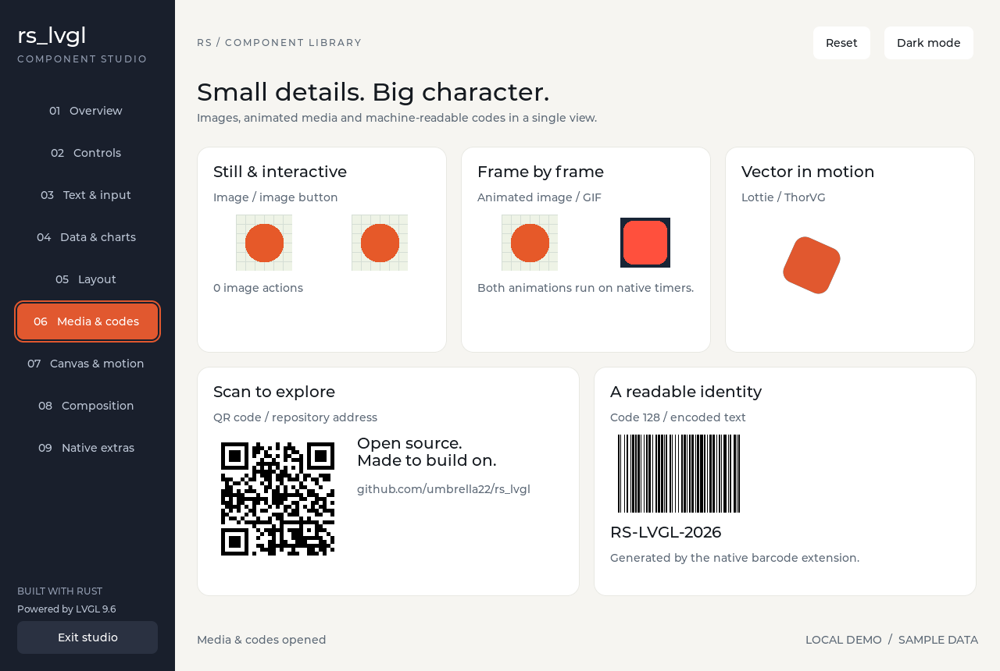
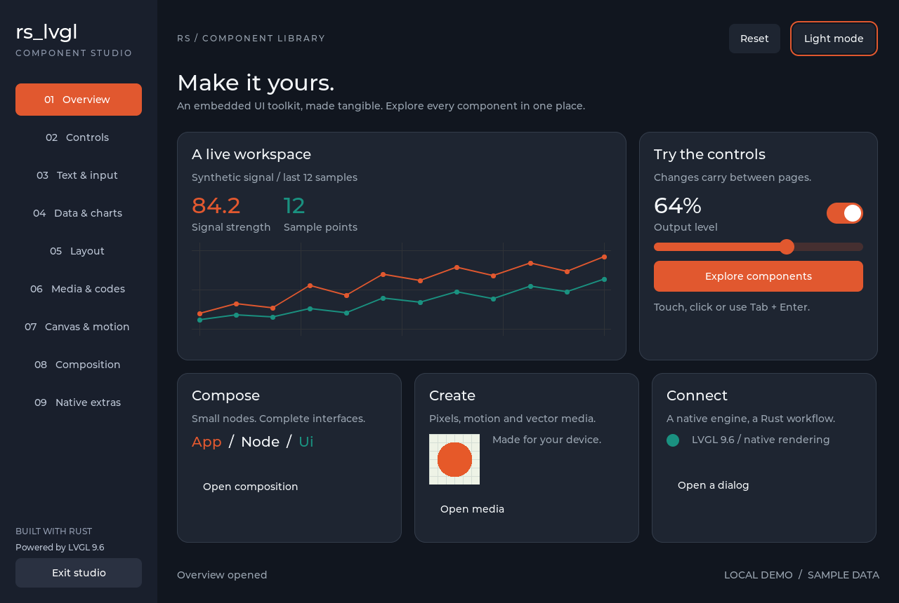

# Component studio

The [component preview](https://umbrella22.github.io/rs_lvgl_website/en/studio.html) compiles the same views to WebAssembly with a canvas display, native input devices and a browser frame loop. All nine categories run without a local compiler service. See the [site build guide](https://github.com/umbrella22/rs_lvgl_website).


The studio is an original native LVGL application with nine categories, shared
application state and light/dark themes. It uses synthetic device data and local
assets; it needs no network service or application filesystem access.

```sh
cargo run -p rs_lvgl_ui --example studio --features showcase
```

The 1280 x 860 window uses the same `App`, `View` and `Ui` APIs as downstream
applications. The layout reserves space around focus outlines and uses explicit
flat button styles. Sidebar navigation changes keyed page trees. Sliders,
switches, text fields, selections and overlays update a shared Rust state.

## Coverage

| Category | Components and native widgets | Demonstrated behavior |
| --- | --- | --- |
| Overview | Label, Button, Row, Column, Obj, Chart, Slider, Switch, Image, Span, LED | Shared output value, navigation, modal dialog and theme switch |
| Controls | Slider, Bar, Switch, Checkbox, LED, Arc, Spinner, Dropdown, Roller, Spinbox, ButtonMatrix | Pointer changes, controlled selection/value, enabled/disabled buttons |
| Text & input | Textarea, Keyboard, PinyinKeyboard, CJK fonts, Calendar, Span | ASCII/Chinese text, keyboard targets, native date selection, wrapping |
| Data & charts | Chart, Table, Scale, Line | Two sample series, table cell events, ticks and polyline rendering |
| Layout | Grid, Row, Column, Obj, Tabview, Tileview | Equal grid tracks, arrow navigation, controlled tabs and swipeable tiles |
| Media & codes | Image, ImageButton, AnimImage, GIF, Lottie, QRCode, Barcode | Retained images, pressed image, native animation timers, encoded data |
| Canvas & motion | Canvas, ArcLabel, custom lifecycle widget, native Animation | Lines/rectangles/text/pixels, curved text, reversible motion, tick-driven opacity |
| Composition | Panel, List/ListItem, NavState, FileExplorer, Dialog, Toasts, layers, Msgbox | Push/back, sample file selection, modal focus, dismissal and toast expiry |
| Native extras | Native List, Menu, Window via `raw` | Native menu page/back, descendant click events observed by a typed parent |

The table covers the current declarative widget/component surface and the three
raw widgets retained by `widgets-all`. It is not a claim to expose every LVGL C
API. LVGL 9.6 deprecates native List/Menu/Window; they remain compatibility samples.
Composition is the preferred path for new Rust lists, navigation and windows.
Native screen transitions are demonstrated separately by the existing
`capabilities` example.

## Controls

Click or touch the sidebar to change categories. Tab/Shift-Tab moves focus and
Enter activates focused actions. The layout grid supports spatial navigation.
Text & input contains an ASCII keyboard and a separate Pinyin keyboard; type
`ni` and choose a candidate in the latter. Reset restores sample state while
preserving the selected category and theme. Exit studio performs normal teardown.

## Rendering and verification

```sh
# Serial native tests, including three complete mount/traverse/unmount lifecycles
cargo test -p rs_lvgl_ui --example studio --features showcase -- --test-threads=1

# Real SDL window with a bounded lifetime and automatic page traversal
STUDIO_FRAMES=460 STUDIO_AUTORUN=1 cargo run -p rs_lvgl_ui --example studio --features showcase

# Native memory-display renders: nine pages and a dark overview
python3 scripts/render-studio.py

# Explicitly refresh the documentation images
python3 scripts/render-studio.py --output docs/images
```

`STUDIO_CAPTURE_DIR` additionally saves lossless PPM snapshots during an SDL run.
The render script uses actual application views on native memory displays; it
converts their RGB pixels to PNG with Python's standard library. No HTML mockup,
composited browser UI or image-generation model participates. A portable receipt
records source/image digests, dimensions, invocation and native test result.

The native class checklist in
[coverage.rs](../rs_lvgl_ui/examples/studio/coverage.rs) is checked against mounted
objects. [Interaction tests](../rs_lvgl_ui/examples/studio/audit.rs) use real native
pointer events and keyboard dispatch. They assert application state, visibility,
modal behavior, descendant events and teardown. Native window execution is a
separate smoke test; neither layer establishes physical-board acceptance.





## Editable interactive examples

The documentation playground accepts `fn app() -> impl rs_lvgl_ui::App`. Its switch
example includes state, messages, `update` and `view`; clicking the rendered switch
updates both native pixels and application text. Bundled presets work on static
hosting. Edited Rust uses the local compiler and then runs in a browser Worker.
See the [playground guide](https://github.com/umbrella22/rs_lvgl_website#interactive-playground).
