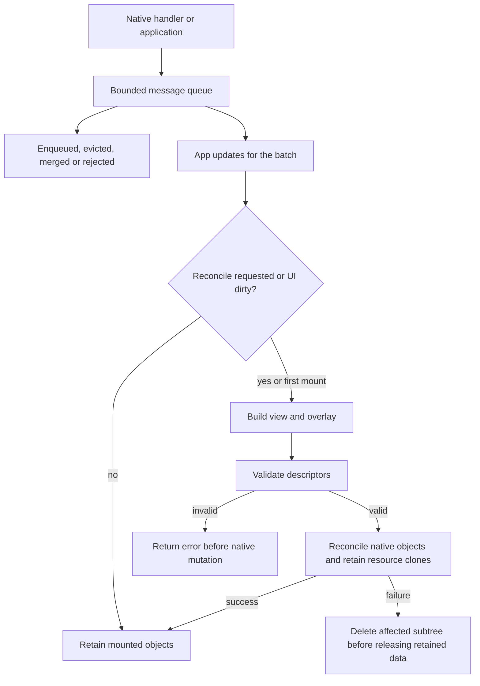

# UI messages, loaded resources and diagnostics

The 0.7.0 runtime provides explicit congestion outcomes, optional diagnostics,
loaded resource retention and render feedback. The library requires `alloc`
and one UI thread. External `NativeObject` implementations must satisfy the
safety requirements below. Version 0.7.0 also implements
[range/text controls, charts and custom properties](ui-capability-depth.md).

Views use flat style modifiers, explicit dimension helpers and component-specific
action types through `App::Action`. The [style and action contracts](ui-styles.md)
cover initialization, precedence, inheritance, theme values and action signatures.



## Native handle safety

`NativeObject` is an unsafe trait. External implementations must establish
that `raw()` refers to an aligned, initialized, live LVGL object in the current
lifecycle on the UI thread, throughout every borrowing operation and its
documented retention. `NonNull` establishes only the non-null property.

An adapter can delegate to a borrowed existing handle:

```rust
use rs_lvgl::{NativeObject, Obj};

pub struct Borrowed<'a, 'b>(&'a mut Obj<'b>);

// SAFETY: the private field borrows a valid Obj and delegates its raw handle.
// This adapter adds no deletion, invalidation or cross-thread access path.
unsafe impl NativeObject for Borrowed<'_, '_> {
    fn raw(&self) -> core::ptr::NonNull<rs_lvgl_sys::lv_obj_t> {
        self.0.raw()
    }
}
```

Changing `impl` to `unsafe impl` also requires reviewing each implementation's
validity and invalidation rules. `Widget::from_raw` remains unsafe and accepts a
borrowed native object; its Rust lifetime parameter does not extend native life.
Generated pointer-taking methods retain their unsafe boundary. These changes
close the safe external trait-implementation route; they do not establish a
complete soundness audit of every wrapper or callback API.

Dropping a `Display` handle still leaves the native display alive. Unmount UIs,
release inputs and resources, and finish rendering/flush/DMA/GPU work before
unsafe display deletion or `deinit`.

## Queue outcomes and native events

`Ui::post` preserves drop-oldest behavior. `Ui::post_with(message, policy)` returns
`Result<PostOutcome<M>, UiError>` with these congestion outcomes:

| Outcome | Delivery and returned data |
| --- | --- |
| `Enqueued` | New message appended. |
| `Evicted(old)` | New message appended; oldest message returned. Retrying the new message duplicates delivery. |
| `Merged` | Application merger replaced the tail. |
| `Rejected(new)` | Queue unchanged; the incoming message returned. |

`QueuePolicy::new(QueueOverflow::RejectNew)` rejects overflow.
`QueueOverflow::DropOldest` selects eviction. A `.coalesce(fn(&M, &M) -> Option<M>)`
merger can replace only the tail, even before the queue is full. Its application
predicate defines identity and meaning, including event source identity; `None`
preserves separate ordered messages. The framework cannot infer that a click,
increment or submit is replaceable.

`set_event_queue_policy` applies the policy to actual native-handler messages.
`set_event_queue_observer(Some(Rc::new(...)))` receives each native enqueue
outcome, including rejected or evicted values. `None` releases the observer.
`queue_stats()` counts evictions, rejections and merges; the existing dropped
counter continues to count evictions. Observers and mergers execute within native
callbacks: they must not unwind, block or reenter the UI. Store follow-up work for
the platform loop. The UI retains observer captures until replacement or drop.

## Loaded image and font lifetime

The first loaded-resource capability supports synchronous software drawing with
`LV_USE_OS == LV_OS_NONE`, accelerator renderers disabled, and both image and
image-header caches disabled. `resource_support()` queries the effective compiled
C configuration through a native shim. An application-supplied header can change
admission; the vendored default is not evidence for another header.

`ImageResource::rgb565(width, height, stride, Rc<[u8]>)` accepts already loaded,
immutable RGB565 rows. Dimensions must be nonzero. Stride is bytes per row,
including padding, and the byte slice has exactly `stride * height` bytes.
Native descriptor limits and configured data/stride alignment are checked.
Invalid layout returns `ResourceError::InvalidLayout`; unsupported configuration
returns `ResourceError::UnsupportedConfiguration`.
RGB565 images also require `LV_DRAW_SW_SUPPORT_RGB565`; disabling that native
input format rejects the image constructor while the font capability remains
available under the synchronous lifetime configuration.

```rust
extern crate alloc;
use alloc::rc::Rc;
use rs_lvgl_ui::prelude::*;

// Requires widget-image and a supported effective native configuration.
fn loaded_views(pixels: Rc<[u8]>) -> Result<View<()>, ResourceError> {
    let resource = ImageResource::rgb565(2, 1, 4, pixels)?;
    Ok(row([
        image_resource(resource.clone()),
        image_resource_scaled(resource, Scale::percent(200)),
    ]))
}
```

Clones share a stable descriptor and pixel allocation. Mounted nodes retain a
clone after the temporary view is discarded. Replacement installs the new native
source before releasing the previous clone; deletion and partial-failure cleanup
delete native objects before releasing retained resources. Caller-held image
handles can outlive unmount. The static/raw `ImageSource` API remains Copy.
The reconciler checks the native source after the void image setter. Decoder
rejection returns `InvalidProperty`; a string allocation failure that leaves the
old source installed returns `Allocation`. Failed-subtree deletion happens while
the old retained reference is still valid.

`FontResource` adapts an already valid native font:

```rust
unsafe fn import_loaded_font<T: 'static>(
    font: core::ptr::NonNull<rs_lvgl_sys::lv_font_t>,
    backing: T,
    destroy: unsafe extern "C" fn(*mut rs_lvgl_sys::lv_font_t),
) -> rs_lvgl_ui::FontResource {
    // SAFETY: the caller must establish the full from_raw_owned contract,
    // including stable backing addresses and the matching loader/destructor.
    unsafe { rs_lvgl_ui::FontResource::from_raw_owned(font, backing, destroy) }
}
```

The transfer is unsafe: callbacks/tables must be valid, backing data must remain
at stable addresses, aliases must not destroy or invalidate the font, and the
destructor must match the allocation/loading API. For an LVGL binfont, that
destructor is `lv_binfont_destroy`; buffer retention also depends on loading mode.
Neither the native destructor nor the backing value's destructor may unwind or
reenter UI operations.
The adapter provides no file loader or untrusted-font parser.

`.font_resource(font.clone())` overrides the node's static main-style font and
supports normal child inheritance. Removing the resource restores the supplied
static style or inherited font. Custom nodes reject this modifier because their
style lifecycle belongs to their custom implementation. Other parts and states
continue to use static styles. `Font`, `Style` and `Theme` remain Copy.

The last font clone invokes the native destructor exactly once, then drops
backing data. **Release every loaded font clone before native `deinit`.** A clone
retained outside the mounted tree still participates in this obligation.
Font mounting on unsupported configuration returns `UiError::InvalidProperty`;
query `resource_support()` for the missing capability.

Raw LVGL cache/renderer reconfiguration while loaded resources are mounted is
outside this contract. GPU, async drawing, runtime cache retirement, decoder
resources and filesystem/network loading need separate lifetime contracts.

## Render feedback and static text

Existing `App::update` implementations continue to reconcile after a processed
message. The default `update_with_render` calls `update` and returns
`RenderDecision::Reconcile`. An override returning `Skip` certifies that neither
view nor overlay nor controlled native state needs correction. Every message in
a batch is processed; any `Reconcile`, dirty/theme change or first mount forces
one rebuild.

A native slider changed from 50 to 80 still needs reconciliation when the model
clamps back to 50. Unchanged model data alone does not justify `Skip`.

`label_static(&'static str)` and `button_static(&'static str)` borrow fixed text
in the Rust descriptor and mounted properties. Existing `label`/`button` still
accept owned strings and short-lived `&str`. LVGL continues to copy changed text
into native storage. Stable child key sequences already in native order reuse
the mounted child vector; inserts, removals, reorders and external native moves
use the full matching/reordering path. There is no subtree cache.

## Chart and custom update state

Chart descriptions contain owned samples or immutable bounded history snapshots.
Native sample arrays contain copies. Last-successful mounted history metadata and
actual sample overlap select incremental appends; gaps, replacement and remount
perform a full synchronization. A discarded view does not advance mounted progress.
Snapshot construction copies the bounded samples and remains part of view cost.

Custom descriptors pair one concrete implementation with boxed Props. Pure
validation precedes mutation of both view and overlay trees. `apply_props` runs
on mount and every matching key/type update, including equal properties.
`Ui::tick` calls the separate animation hook. On failed partial application, old
and incoming Props remain live while the affected subtree is deleted. The delete
hook runs once while the native root is live; the widget and Props survive native
delete callbacks and drop afterwards. Create failure cleans up within the create
hook. These paths preserve the existing no-unwind and non-reentrant UI rules.
The [capability guide](ui-capability-depth.md) specifies each hook and recovery path.

## Diagnostics and strict properties

`diagnostics` enables `set_diagnostic_sink` and structured events. `Tree` selects
view or overlay; balanced `Enter`/`Exit` events identify a path by key, child index,
widget type and Validation/Create/Update stage. Child indices disambiguate Auto
keys and repeated names in different parents. `Error` reports the deepest failure
once. Property identifiers describe validation groups; native create/update
failures can use the general `Value` identifier when LVGL supplies no finer error.

The stream contains node keys and fixed metadata, excluding property text, image
bytes and input values. Applications control whether their keys contain sensitive
identifiers. Sinks must not unwind or reenter UI operations. The sink feature
adds no mandatory logging backend or path-string allocation.
A sink panic aborts through an internal non-unwinding callback boundary, so it
cannot unwind past partially mounted native objects and release retained data.

`strict-properties` rejects wrong-kind dedicated modifiers before native mutation,
including after `Node::map`. For example, `label("x").password(true)` is rejected
with `InvalidProperty` when `widget-textarea` and strict checking are enabled.
Default behavior continues to ignore the modifier; diagnostics alone emits
`IgnoredProperty`. Shared layout/style APIs and unified `View<M>` composition
remain available. Development `typed::...` constructors reject wrong dedicated
properties at compile time until `.into_view()` erases the marker. Runtime range,
identity, resource and allocation checks still apply. See
[composition and controlled forms](ui-composition.md).

Allocation accounting, compile-fail consumers, effective-configuration rejection,
resource lifecycle workloads and native display checks are described in
[host validation](testing.md).
