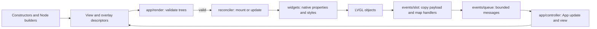

# Declarative UI source map

`rs_lvgl_ui` separates pure view descriptions from native LVGL state. The public
API is exported by [lib.rs](../rs_lvgl_ui/src/lib.rs) and
[prelude.rs](../rs_lvgl_ui/src/prelude.rs); implementation directories remain
private. Shared implementation functions use internal visibility.



Invalid descriptors return before native mutation. A native reconciliation failure
retires the affected subtree before releasing its retained buffers, fonts and
handler captures. The next render can recreate that tree from application state.
The [runtime and resource contracts](ui-runtime.md) describe these failure and
lifetime rules in detail.

## Source responsibilities

| Directory | Responsibility and entry points |
| --- | --- |
| [constructors/](../rs_lvgl_ui/src/constructors/mod.rs) | Ordinary functions grouped into layout, controls, data, media and custom views. They construct descriptors without calling LVGL. |
| [node/](../rs_lvgl_ui/src/node/mod.rs) | `Node` fields, identity and construction defaults. `kind.rs` defines feature-gated widget descriptions; `types/` defines fonts, images, layout, style selectors and control values. |
| [node/builders/](../rs_lvgl_ui/src/node/builders/mod.rs) | Tree/style/grid modifiers, widget-specific properties, interaction/scroll settings and event builders. Wrong-kind modifiers retain the existing diagnostic/strict-property behavior. |
| [node/validation/](../rs_lvgl_ui/src/node/validation/mod.rs) | Diagnostic traversal, sibling/keyboard identity and style/navigation checks. `kinds.rs` checks each widget's native representation and shares range/option validation. |
| [theme/](../rs_lvgl_ui/src/theme/mod.rs) | `Style` data/defaults and `Theme` tokens. Builders, field merging and themed presets have separate files. Native style application belongs to `widgets/style.rs`. |
| [app/](../rs_lvgl_ui/src/app/mod.rs) | `App`, `Ui` and statistics. `controller.rs` handles public operations and message batches; `render.rs` validates and reconciles both trees; `input.rs`, `lifecycle.rs` and `guard.rs` handle focus, teardown and reentrancy. |
| [reconciler/](../rs_lvgl_ui/src/reconciler/mod.rs) | Mounted native state. `mount.rs` and `update.rs` apply tree changes; `children.rs` matches keys and plans moves; `keyboard.rs` resolves/unbinds targets; `styles.rs`, `interaction.rs` and `mounted.rs` handle styles, handlers and custom lifecycle. |
| [widgets/](../rs_lvgl_ui/src/widgets/mod.rs) | Native adapters. `kind.rs` classifies widgets; `props.rs` projects descriptions and decides structural recreation; `retained.rs` holds stable native buffers/private parts; creation, grid layout, pages and styles have separate modules. |
| [widgets/properties/](../rs_lvgl_ui/src/widgets/properties/mod.rs) | Exhaustive property dispatch into base text/buttons, choices, numeric ranges, data/indicators, text, media, message boxes and extensions. `common.rs` shares native text and checked-state writes. |
| [events/](../rs_lvgl_ui/src/events/mod.rs) | Copied payloads, native value decoding and bounded queue policy. `slot/mod.rs` registers callbacks, `slot/dispatch.rs` maps handlers, and `slot/native.rs` contains C entry points and slot cleanup. |
| [components/](../rs_lvgl_ui/src/components/mod.rs) | Composite views built from ordinary constructors: panels, lists, navigation, dialogs and toasts. |
| [extensions/](../rs_lvgl_ui/src/extensions/mod.rs) | Optional barcode, QR, GIF, Lottie and Pinyin descriptions/native integration. |

Smaller focused modules remain at the source root: animation and transitions,
loaded resources, custom widgets, focus/grid navigation, scrolling, canvas and
graphics, diagnostics, screens, style extensions, symbols and metrics.

## State and shared operations

`Node<M>` is a temporary description. `node/mapping.rs` changes its message type;
`HandlerSet::map` adapts independent handlers and shares owned-payload conversion.
Neither operation mounts objects or changes queue delivery order.

`MountedNode<M>` retains the native object, previous props/styles, resource
references, children and custom-widget state. Destruction runs custom delete
hooks while objects are live, deletes native objects, then releases Rust data.
Grid templates, image descriptors and native pointer arrays retain stable heap
addresses throughout that native use.

`widgets::apply_props` dispatches by the new widget kind. Each family handler
compares previous descriptions for static properties and queries LVGL for
controlled values. Reading the current native value preserves application
correction after native input changes a slider, checked state, text or selection.
The shared `suppress` function pairs a synchronous programmatic write with the
slot's existing feedback suppression, including writes that return a result.

`EventQueue<M>` handles congestion independently from handler registration.
`HandlerSlot<M>` has a stable address until its native deletion callback runs.
Native callbacks copy payloads, invoke the installed mappings and enqueue
messages; application updates and reconciliation run later through `Ui::drain`.
Callbacks, observers and mergers retain their non-unwinding/UI-thread contracts.

## Change paths

A widget addition crosses the descriptor/native boundary in explicit places:

1. `node/kind.rs` and the relevant `constructors/` and `node/types/` files define
   its description, constructor and values. Widget-specific modifiers belong in
   `node/builders/widgets.rs`; validation belongs in `node/validation/kinds.rs`.
2. `widgets/props.rs` defines the retained projection and structural replacement
   rule. `widgets/kind.rs` defines identity and event value classification.
3. `widgets/create.rs` creates the native object. A property-family handler
   applies updates through the exhaustive dispatcher. Buffers referenced by C
   belong in `widgets/retained.rs` and must survive native failure cleanup.
4. `events/value.rs` decodes a new native value source when needed. Existing
   root/prelude capability gates and public safety contracts apply throughout.

A reconciliation change belongs to the phase that makes the decision: sibling
identity/order in `children.rs`, kind replacement in `update.rs`, keyboard
references in `keyboard.rs`, and cleanup in `mounted.rs` or `app/lifecycle.rs`.
Public operation scheduling remains in `app/controller.rs`.

## Validation entry points

Native tests share LVGL global state and run serially. The full UI combination
and a reduced configuration cover different cfg paths:

```sh
cargo test -p rs_lvgl_ui --features showcase,font-cjk-14,rust_timer,diagnostics,strict-properties -- --test-threads=1
cargo test -p rs_lvgl_ui --no-default-features --features alloc,components -- --test-threads=1
python3 scripts/check-ui-api.py
python3 scripts/check-ui-leaks.py
python3 scripts/check-ui-examples.py
```

The [CI workflow](../.github/workflows/rust.yml) defines the remaining supported
feature checks. API controls compile external `no_std` consumers and expected
failures. Heap controls measure Rust and LVGL allocations. Example journeys
exercise native views and bounded SDL runs; they do not certify physical boards
or an external native provider.
